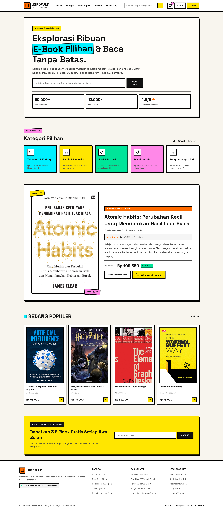

# LIBROPUNK — E-Book Marketplace

Landing page responsif untuk LIBROPUNK, sebuah toko buku digital independen. Halaman ini memperkenalkan katalog e-book, menonjolkan buku pilihan, dan memberi jalur bagi pengunjung untuk menjelajahi kategori serta buku populer.

## Hasil tampilan

### Desktop



### Mobile


## Fitur dan bagian halaman

- **Navbar** dengan logo LIBROPUNK, tautan navigasi, kolom pencarian, keranjang, serta tombol Masuk dan Daftar.
- **Hero** dengan pengenalan katalog, kolom pencarian, dan ringkasan statistik toko.
- **Kategori pilihan** untuk Teknologi & Koding, Bisnis & Finansial, Fiksi & Fantasi, Desain Grafis, dan Pengembangan Diri.
- **Buku unggulan** yang menampilkan *Atomic Habits* karya James Clear, rating, informasi diskon, harga, dan tombol aksi.
- **Buku populer** dengan sampul, judul, penulis, harga, serta kontrol tambah ke keranjang.
- **Newsletter** untuk penawaran e-book dan pembaruan katalog.
- **Footer** berisi identitas toko dan tautan informasi.

## Spesifikasi desain

- Gaya visual **neobrutalist**: garis tebal hitam, bayangan keras, warna kontras, dan panel seperti kartu.
- Latar hangat `#F8F5EE` dipadukan dengan aksen oranye, kuning, cyan, hijau, dan pink.
- Tipografi menggunakan **Plus Jakarta Sans** untuk teks dan **Space Grotesk** untuk judul serta elemen yang ditebalkan.
- Layout menyesuaikan layar desktop dan mobile menggunakan CSS responsif.
- Interaksi visual mencakup keadaan fokus pada kolom pencarian dan tombol, hover pada elemen interaktif, serta navigasi anchor ke bagian halaman.

## Teknologi

- HTML5
- CSS3
- Google Fonts: Plus Jakarta Sans dan Space Grotesk
- Aset gambar buku dan ikon SVG lokal

## Struktur proyek

```text
assignment-1/
├── index.html
├── styles/
│   └── style.css
└── assets/
    ├── icons/
    └── images/
```

## Menjalankan halaman

Buka `index.html` di browser. Untuk hasil yang konsisten saat meninjau, pastikan koneksi internet tersedia agar Google Fonts dapat dimuat.
