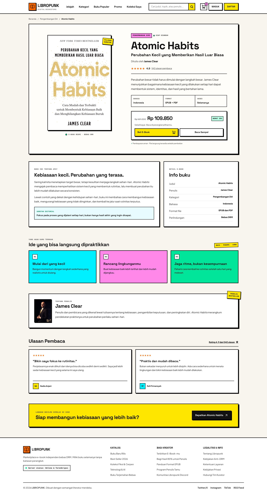

# LIBROPUNK — Detail E-Book Atomic Habits

Halaman detail e-book untuk toko digital LIBROPUNK. Halaman ini berfokus pada **Atomic Habits** karya James Clear, dengan informasi yang konsisten antara sampul, penulis, kategori, ringkasan, harga, dan ulasan.

## Hasil tampilan

### Desktop



### Mobile


## Yang dibuat

Halaman detail ini membantu calon pembaca memahami isi e-book dan menemukan informasi penting sebelum memilih aksi pembelian. Kontennya meliputi:

- **Navbar LIBROPUNK** dengan navigasi, pencarian, keranjang, serta tombol masuk dan daftar.
- **Breadcrumb** untuk menunjukkan posisi buku di kategori Pengembangan Diri.
- **Ringkasan buku** dengan sampul, judul dan subjudul, penulis, rating, format, bahasa, dan status akses.
- **Panel harga dan aksi** yang menampilkan harga sebelum dan sesudah diskon, tombol beli, dan tombol baca sampel.
- **Tentang buku dan info e-book**, termasuk format EPUB/PDF dan keterangan bebas DRM.
- **Pokok bahasan** tentang kebiasaan kecil, menata lingkungan, dan menjaga konsistensi.
- **Profil James Clear** dengan foto penulis.
- **Ulasan pembaca** dan ajakan untuk mendapatkan buku.
- **Footer LIBROPUNK** dengan tautan katalog, kreator, serta informasi.

## Spesifikasi desain

- Gaya neobrutalist dengan border hitam tebal, bayangan keras, dan kartu yang tegas.
- Latar krem hangat dengan aksen kuning, oranye, cyan, pink, dan hijau.
- Tipografi **Plus Jakarta Sans** untuk teks dan **Space Grotesk** untuk judul serta elemen tegas.
- Tata letak responsif untuk desktop dan mobile; susunan informasi dan aksi menyesuaikan lebar layar.
- Navbar dan footer mengikuti identitas visual LIBROPUNK, sementara konten utama dirancang khusus untuk halaman detail e-book.

## Teknologi

- HTML5
- Tailwind CSS v4
- Vite
- Google Fonts: Plus Jakarta Sans dan Space Grotesk
- Aset sampul, foto penulis, dan ikon SVG

## Menjalankan proyek

Pastikan Node.js dan npm tersedia, lalu jalankan dari folder `assignment-2`:

```bash
npm install
npm run dev
```

## Struktur utama

```text
assignment-2/
├── index.html
├── src/
│   └── style.css
├── public/
│   └── assets/
│       ├── icons/
│       └── images/
└── vite.config.js
```

Halaman ini merupakan antarmuka statis untuk kebutuhan tugas desain dan implementasi front-end. Tombol dan tautan ditampilkan sebagai bagian dari rancangan pengalaman halaman.

